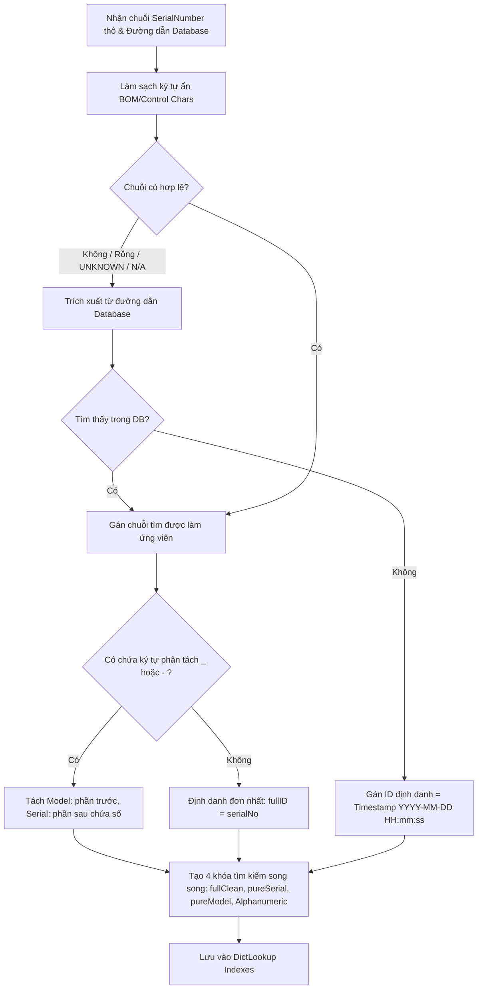

# TÀI LIỆU ĐẶC TẢ THUẬT TOÁN HỆ THỐNG SCANNER V2

Tài liệu chi tiết về các thuật toán cốt lõi trong phiên bản **Scanner v2**: Bóc tách định danh không mất mát, Phân tích Lược đồ Đa tệp Động, Động cơ Phân tích Năng lực Quy trình Cpk, và Thuật toán Tính toán KPI Chất lượng.

---

## ⚡ 1. Thuật Toán Bóc Tách & Chuẩn Hóa Định Danh (Lossless Identifier Decomposition)

### 1.1. Mục tiêu:
- Bóc tách chính xác **Model/Part Number** và **Serial Number** từ chuỗi thô.
- Không làm dính chuỗi thành một khối khó phân biệt như v1.
- Hỗ trợ ký tự đặc biệt (`-`, `_`, `/`, `#`, `.`, `°C`, `Ω`) mà không bị lỗi bộ nhớ hay vỡ regex.
- Tự động truy xuất Fallback từ cột `Database` khi cột `SerialNumber` bị rỗng/UNKNOWN.

### 1.2. Sơ đồ thuật toán:

---

## 📂 2. Thuật Toán Phân Tích Lược Đồ Đa Tệp Động (Dynamic Multi-File Schema Parser)

### 2.1. Vấn đề giải quyết:
Khi người dùng nạp đồng thời nhiều tệp từ các trạm đo khác nhau với số lượng cột và thứ tự task khác biệt (ví dụ tệp 57 cột đo 32W và tệp 73 cột đo 4V/16V), thuật toán sẽ:
1. Tạo một đối tượng `FileSchema` độc lập cho từng tệp.
2. Quét qua dòng tiêu đề để nhận diện vai trò của từng cột:
   - **Metadata Index**: Date, Time, UTC, Serial, User, Database.
   - **Verdict Index**: Cột phán định Pass/Fail của từng task con.
   - **Grade Index**: Cột phân hạng chất lượng.
   - **Metric Index**: Cặp 4 cột tương ứng: `Giá trị đo` $\leftrightarrow$ `MinLimit` $\leftrightarrow$ `MaxLimit` $\leftrightarrow$ `Đơn vị`.
3. Cho phép hợp nhất dữ liệu toàn cục để hiển thị tổng quan hoặc lọc phân tích riêng từng tệp/trạm đo theo nhu cầu.

---

## 📈 3. Động Cơ Phân Tích Năng Lực Quy Trình & Cpk (Process Capability Engine)

### 3.1. Các công thức toán học thống kê:

1. **Giá trị trung bình mẫu (Sample Mean)**:
   $$\mu = \bar{X} = \frac{1}{N} \sum_{i=1}^{N} x_i$$

2. **Độ lệch chuẩn mẫu (Sample Standard Deviation)**:
   $$\sigma = s = \sqrt{\frac{1}{N-1} \sum_{i=1}^{N} (x_i - \bar{X})^2}$$

3. **Chỉ số năng lực tiềm năng (Potential Capability Index - $C_p$)**:
   $$C_p = \frac{\text{USL} - \text{LSL}}{6\sigma}$$

4. **Chỉ số năng lực thực tế (Actual Process Capability Index - $C_{pk}$)**:
   $$C_{pl} = \frac{\bar{X} - \text{LSL}}{3\sigma}, \quad C_{pu} = \frac{\text{USL} - \bar{X}}{3\sigma}$$
   $$C_{pk} = \min(C_{pl}, C_{pu})$$

5. **Đánh giá mức độ năng lực**:
   - $C_{pk} \ge 1.67$: **Xuất sắc (6-Sigma Class)** - Quy trình cực kỳ ổn định, tỷ lệ lỗi dưới 1 PPM.
   - $1.33 \le C_{pk} < 1.67$: **Đạt năng lực (Capable)** - Đạt chuẩn sản xuất hàng loạt ổn định.
   - $1.00 \le C_{pk} < 1.33$: **Cận biên (Marginal)** - Cần theo dõi và kiểm soát chặt chẽ.
   - $C_{pk} < 1.00$: **Không đạt năng lực (Incapable)** - Phát sinh sản phẩm lỗi ngoài dung sai.

### 3.2. Thuật toán phát hiện Cận Biên Lỗi (Near-Fail / Marginal Pass Detection):
- Một sản phẩm được coi là **Near-Fail (Cảnh báo cận biên)** khi nó có kết quả PASS nhưng giá trị đo nằm trong khoảng dung sai hẹp $\Delta_{\text{margin}}$ (mặc định $10\%$) sát mép $LSL$ hoặc $USL$:
  $$x_i \in [\text{LSL}, \text{LSL} + 0.10 \times (\text{USL} - \text{LSL})] \quad \text{hoặc} \quad x_i \in [\text{USL} - 0.10 \times (\text{USL} - \text{LSL}), \text{USL}]$$
- Giúp kỹ sư chất lượng phát hiện xu hướng trôi thông số (Parameter Drift) trước khi xuất hiện hàng NG.

---

## 🎯 4. Thuật Toán Phân Tích Lô Sản Xuất & FPY (First Pass Yield)

1. **Gom nhóm theo DUT**: Mỗi sản phẩm có số seri duy nhất được gom tất cả các lần đo theo trình tự thời gian $t_1 < t_2 < \dots < t_k$.
2. **Ngưỡng tách chu kỳ (Time Gap Threshold)**: Nếu khoảng thời gian giữa 2 lần đo liên tiếp $\Delta t = t_{i+1} - t_i > T_{\text{gap}}$ (mặc định 2 tuần), hệ thống sẽ tự động tách thành 2 sự kiện sản xuất độc lập.
3. **First Pass Yield (FPY)**:
   $$\text{FPY} = \left( \frac{\sum [ \text{isRecordPass}(DUT.firstRun) = \text{True} ]}{\text{Tổng số sản phẩm độc lập}} \right) \times 100\%$$
4. **Final Pass Yield (Tỷ lệ Đạt Thực Tế)**:
   $$\text{Final Yield} = \left( \frac{\sum [ \text{isRecordPass}(DUT.lastRun) = \text{True} ]}{\text{Tổng số sản phẩm độc lập}} \right) \times 100\%$$
