# ĐẶC TẢ KỸ THUẬT NHẬT KÝ KIỂM ĐỊNH KLIPPEL SUMMARY LOG (KLIPPEL QC & dB-LAB SPECIFICATION)

Tài liệu quy chuẩn phân tích dữ liệu, giải mã trường thông tin và khai thác 100% giá trị kỹ thuật từ tệp **Klippel Quality Control (QC) Summary Log** (tham chiếu tiêu chuẩn [klippel.de](https://www.klippel.de)).

---

## 📌 1. Giới Thiệu & Bản Chất Của Klippel Summary Log

Hệ thống kiểm tra chất lượng tự động **Klippel QC** (Quality Control) và **dB-Lab** là tiêu chuẩn công nghiệp toàn cầu trong sản xuất củ loa (transducers), hệ thống loa (loudspeakers), micro và tai nghe.

Sau mỗi lượt đo của một sản phẩm thử nghiệm (DUT - Device Under Test), hệ thống Klippel QC sẽ tự động ghi nối tiếp (append) một bản ghi kết quả vào tệp **Summary Log** (dưới dạng Plain Text Tab-Separated Values `.log` hoặc `.txt`).

### Đặc điểm định dạng vật lý:
1. **Bảng mã ký tự**: UTF-8 hoặc ANSI/ASCII.
2. **Ký tự phân tách (Delimiter)**: Mặc định là dấu Tab (`\t`), hoặc dấu phẩy (`,`), chấm phẩy (`;`).
3. **Dòng 1 (Header Row)**: Khai báo toàn bộ tên trường dữ liệu, tiền tố phán định (`Verdict-`), phân hạng (`Grade-`), giá trị đo thông số, giới hạn dung sai kỹ thuật (`MinLimit-`, `MaxLimit-`), và đơn vị đo (`Unit-`).
4. **Dòng 2 trở đi (Data Rows)**: Chứa kết quả đo của từng lượt thử nghiệm.
5. **Giá trị số thực**: Định dạng số khoa học (Scientific Exponential Notation), ví dụ: `1.04765244e+002` ($= 104.765$), `1.82016212e+001` ($= 18.201$), `5.41666666e-004` ($= 0.00054166$). Giá trị không khả dụng được ghi là `Nan` hoặc để trống.

---

## 📊 2. Phân Nhóm 4 Trụ Cột Thông Tin Của Klippel Summary Log

Một tệp Summary Log hoàn chỉnh của Klippel chứa 4 nhóm dữ liệu cơ bản:

```mermaid
graph TD
    KLIPPEL[Klippel Summary Log] --> G1[1. Định Danh & Truy Xuất Nguồn Gốc]
    KLIPPEL --> G2[2. Phán Định Verdict & Phân Hạng Grade]
    KLIPPEL --> G3[3. Thông Số Đo Thực Tế & Dung Sai Kỹ Thuật]
    KLIPPEL --> G4[4. Điều Kiện Kích Thích & Môi Trường]

    G1 --> G1_1[Date, Time, UTC-Offset]
    G1 --> G1_2[SerialNumber, UserName]
    G1 --> G1_3[Database: Chuyền, Lô hàng, Thư mục Pass/Fail, Tên DUT]

    G2 --> G2_1[Verdict-Overal: Phán định tổng hợp DUT]
    G2 --> G2_2[Verdict-Task: Từng hạng mục kiểm tra]
    G2 --> G2_3[Grade-Task: Phân hạng chất lượng theo mức dung sai]

    G3 --> G3_1[Giá trị thực tế: Re, Fs, Qts, Level, ImpPt, Delay...]
    G3 --> G3_2[MinLimit LSL & MaxLimit USL]
    G3 --> G3_3[Unit: Ohm, Hz, dB re 20uPa, %, s, °C]

    G4 --> G4_1[Điện áp / Công suất kích thích: 4V, 16V, 32W, 5W]
    G4 --> G4_2[Độ phân giải tần số: 1/12 Octave, Chirp, Multitone]
    G4 --> G4_3[Môi trường: Temperature °C, Humidity %]
```

---

## 🔬 3. Danh Mục Các Thông Số Đo Âm Học & Cơ Điện Loa Chuẩn Klippel

| Tên Task / Thông Số | Nhãn Cột Trong Header | Tên Chuyên Môn Quốc Tế | Đơn Vị Đo Chuẩn | Ý Nghĩa Kiểm Định & Nguyên Nhân Lỗi Điển Hình |
| :--- | :--- | :--- | :--- | :--- |
| **Độ nhạy âm thanh** | `level - <Cond>` | Sound Pressure Level (SPL) | $\text{dB (re } 20\mu\text{Pa)}$, $\text{dBA}$ | Mức áp suất âm thanh trung bình. Thấp do nam châm yếu, hở buồng âm, sai khe từ. |
| **Đáp tuyến tần số** | `resp - <Cond>` | Frequency Response (Magnitude) | $\text{dB SPL}$ | Biên độ đường cong đáp tần theo dải. Lỗi màng loa, gân loa, nhện loa hoặc buồng âm. |
| **Cực tính** | `pol - <Cond>` | Polarity / Phase | $\pm$ (Góc pha / Pha cực tính) | Đấu ngược dây cuộn âm (dương/âm đảo ngược), làm triệt tiêu âm thanh khi ghép cặp. |
| **Méo hài tổng** | `thd - <Cond>` | Total Harmonic Distortion (THD) | $\%$ hoặc $\text{dB}$ | Méo phi tuyến tổng thể. Do phi tuyến trường từ $B(x)$, độ cứng nhện $K(x)$ hoặc quá tải công suất. |
| **Hài bậc 2** | `harm2 - <Cond>` | 2nd Harmonic Distortion (HD2) | $\%$ hoặc $\text{dB}$ | Biểu thị sự bất đối xứng của hành trình cuộn dây coil (cuộn dây bị lệch tâm trên/dưới khe từ). |
| **Hài bậc 3** | `harm3 - <Cond>` | 3rd Harmonic Distortion (HD3) | $\%$ hoặc $\text{dB}$ | Biểu thị sự giới hạn đối xứng (gân hoặc nhện bị căng cứng ở cả 2 biên độ hành trình). |
| **Dị âm cọ xát / Rung**| `rbz - <Cond>` | Rub & Buzz (Impulsive Distortion) | $\%$ hoặc $\text{dBA}$ | Lỗi nghiêm trọng do cuộn coil cọ vào khe từ (pole piece), bụi kim loại, dây dẫn chạm màng. |
| **Dị âm ngẫu nhiên** | `rrbz - <Cond>` | Sensitive / Random Rub & Buzz | $\%$ hoặc $\text{dBA}$ | Phát hiện tiếng rè, tiếng xì nhỏ li ti, lỏng keo dán gân màng, nứt vành loa. |
| **Điện trở DC** | `re` hoặc `re - <Cond>` | Voice Coil DC Resistance ($R_e$) | $\Omega$ (Ohm) | Điện trở thuần của cuộn dây âm thanh. Sai số do sai tiết diện dây đồng, ngắn mạch hoặc đứt ngầm. |
| **Tần số cộng hưởng** | `fs` hoặc `fs - <Cond>` | Resonance Frequency ($f_s$) | $\text{Hz}$ | Tần số cộng hưởng cơ bản của củ loa. Bị lệch do độ cứng gân/nhện sai lệch hoặc khối lượng màng sai. |
| **Hệ số phẩm chất** | `qts` hoặc `qts - <Cond>`| Total Quality Factor ($Q_{ts}$) | Không thứ nguyên | Hệ số phẩm chất toàn phần của loa. Quyết định đáp ứng tần số thấp và độ tắt dần dao động. |
| **Trở kháng điểm** | `impPt - <Cond>` | Impedance at Single Test Point | $\Omega$ (Ohm) | Giá trị trở kháng tại tần số chỉ định (ví dụ $1\text{kHz}$). |
| **Đường cong trở kháng**| `imp - <Cond>` | Impedance Curve | $\Omega$ (Ohm) | Đánh giá tổng thể đường cong trở kháng theo toàn dải tần số. |
| **Sai số mô hình** | `rmseZ - <Cond>` | Root Mean Square Error of Impedance | $\%$ | Độ lệch giữa đường cong trở kháng đo thực tế và mô hình Thiele-Small lý thuyết. |
| **Độ trễ truyền âm** | `SPL_Delay` | Acoustic Propagation Delay | $\text{s}$ (hoặc $\text{ms}$) | Thời gian sóng âm truyền từ mặt loa tới micro đo. Giúp phát hiện sai vị trí gá đặt jig đo. |
| **Nhiệt độ môi trường** | `Temperature` | Ambient Temperature | $^\circ\text{C}$ | Nhiệt độ phòng đo. Điện trở $R_e$ tăng theo nhiệt độ dây đồng ($\approx +0.393\%/^\circ\text{C}$). |
| **Độ ẩm môi trường** | `Humidity` | Ambient Humidity | $\%$ | Độ ẩm ảnh hưởng đến khối lượng màng giấy và độ đàn hồi gân nhện. |

---

## 🏷️ 4. Quy Chuẩn Đặt Tên & Cấu Trúc Cột Của Klippel

Trong Klippel Summary Log, tên các cột tuân theo cú pháp chuẩn hóa:

### 4.1. Cột Phán Định (Verdict Columns):
- **Cú pháp**: `Verdict-<Tên Task> [ - <Điều kiện thử nghiệm>]`
- **Ví dụ**:
  - `Verdict-Overal` (hoặc `Verdict-Overall`): Kết luận tổng hợp (PASS nếu tất cả task con đều PASS).
  - `Verdict-resp - 4V 1/12`: Phán định đáp tuyến tần số tại điện áp $4\text{V}$, độ phân giải $1/12$ octave.
  - `Verdict-rbz - 16V 1/12`: Phán định Rub & Buzz tại điện áp kích thích mạnh $16\text{V}$.
  - `Verdict-thd - THD 5W`: Phán định méo phi tuyến tại công suất $5\text{W}$.
- **Quy ước giá trị phán định**:
  - `1`, `"PASS"`, `"TRUE"` $\rightarrow$ **PASS (ĐẠT)**
  - `0`, `"FAIL"`, `"NG"`, `"FALSE"` $\rightarrow$ **FAIL (KHÔNG ĐẠT / LỖI)**
  - `-1`, `""`, `"NA"`, `"N/A"`, `"SKIP"` $\rightarrow$ **NOT TESTED (KHÔNG ĐO / BỎ QUA / BỊ NHIỄU NOISE)**

### 4.2. Cột Phân Hạng Chất Lượng (Grade Columns):
- **Cú pháp**: `Grade-<Tên Task> [ - <Điều kiện>]`
- **Ví dụ**: `Grade-level - 4V 1/12`, `Grade-fs - 4V 1/12`.
- **Giá trị**: Số nguyên phân hạng (ví dụ `1` = Grade A cao cấp, `2` = Grade B tiêu chuẩn, `3` = Grade C cận chuẩn) khi kích hoạt tính năng Multi-Limit Grading trong Klippel QC.

### 4.3. Cột Giá Trị Đo Liên Tục & Giới Hạn Dung Sai (Parametric & Limits):
- **Cột giá trị đo**: `<Tên Task> [ - <Điều kiện>]` (ví dụ `re`, `fs`, `level - 4V 1/12`, `impPt - 4V 1/12`).
- **Cột giới hạn dưới (Lower Spec Limit - LSL)**: `MinLimit-<Tên Task> [ - <Điều kiện>]` (ví dụ `MinLimit-fs - 4V 1/12`).
- **Cột giới hạn trên (Upper Spec Limit - USL)**: `MaxLimit-<Tên Task> [ - <Điều kiện>]` (ví dụ `MaxLimit-fs - 4V 1/12`).
- **Cột đơn vị vật lý**: `Unit-<Tên Task> [ - <Điều kiện>]` (ví dụ `Unit-level - 4V 1/12`).

---

## 🗂️ 5. Cấu Trúc Đường Dẫn Cột `Database` Và Ý Nghĩa Truy Xuất

Cột `Database` trong tệp log lưu đường dẫn tuyệt đối đến tệp cơ sở dữ liệu đo chi tiết `.kdb` hoặc `.kdbx`. Đường dẫn này chứa rất nhiều thông tin sản xuất quý giá:

**Ví dụ thực tế**:
`D:\SAS208-01\2026\T35\T6\659841 SPA 2082 TP17 SX 2.6\pass\DUT P2001315-10-B_SIEV261531B1102 2026-06-05 12-41-43-0 UTC+0700.kdbx`

Bóc tách thông tin tự động:
1. **Mã trạm đo / Chuyền sản xuất**: `SAS208-01` (Trạm đo tự động số 1 của chuyền SAS 208).
2. **Thời gian đo**: Năm `2026`, Tuần `T35`, Tháng `T6`.
3. **Mã dự án / Mã đơn hàng**: `659841 SPA 2082 TP17 SX 2.6`.
4. **Phân loại kết quả tại chỗ**: Thư mục `pass` hoặc `fail`.
5. **Tên DUT / Định danh mẫu**: `DUT P2001315-10-B_SIEV261531B1102 2026-06-05 12-41-43-0 UTC+0700`.
   - Mã Model/Part Number: `P2001315-10-B`
   - Mã Serial Number: `SIEV261531B1102`
   - Timestamp đo chính xác: `2026-06-05 12:41:43.0`
