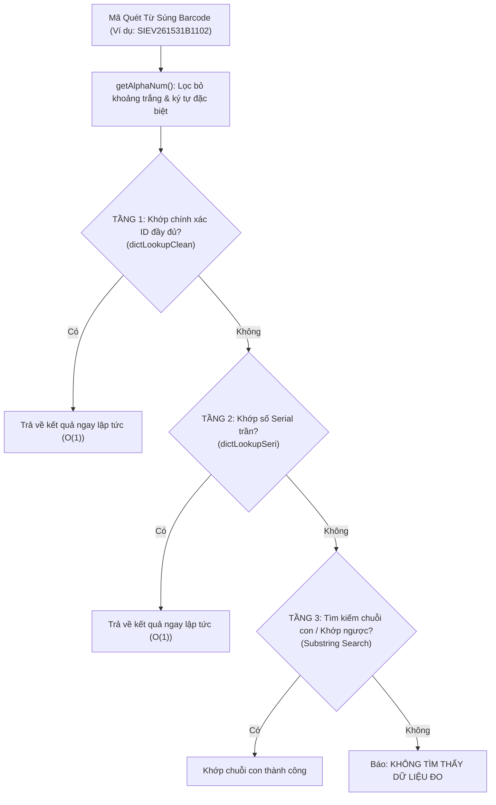

# ⚡ QIT SCANNER V2 — ADVANCED KLIPPEL QC LOG PARSER & QUALITY ANALYTICS

<p align="center">
  
  
  
  
  
  
</p>

---

## 📖 Giới Thiệu Tổng Quan (Executive Overview)

**QIT Scanner V2** là hệ thống phần mềm chuyên dụng dành cho các kỹ sư Đảm bảo Chất lượng (QA/QE), Kỹ sư Sản phẩm (PE/TE) và Kỹ thuật viên âm học tại các nhà máy sản xuất loa, củ loa (*transducers*) và thiết bị âm thanh.

Hệ thống được thiết kế để:
1. **Khai thác 100% dữ liệu từ tệp Klippel QC Summary Log** (`.log`, `.txt`, `.csv`) xuất từ phần mềm kiểm âm tiêu chuẩn quốc tế **Klippel QC** và **dB-Lab** ([klippel.de](https://www.klippel.de)).
2. **Đối soát mã vạch siêu tốc dưới 1 mili-giây ($O(1)$)** bằng súng quét USB trong dây chuyền đóng gói, lắp ráp và kiểm tra thành phẩm.
3. **Phân tích năng lực quy trình sản xuất Six Sigma ($C_p, C_{pk}$)**, vẽ biểu đồ phân phối chuẩn Gauss và cảnh báo sớm sản phẩm **Cận Biên Lỗi (Near-Fail)** trước khi phát sinh hàng phế phẩm hàng loạt.
4. **Hoạt động 100% Offline (Không cần Internet hay máy chủ)**, có thể chạy trực tiếp trên trình duyệt hoặc đóng gói thành **1 tệp HTML Standalone duy nhất** gửi qua Zalo/Email cho xưởng sản xuất.

---

## 🌟 Bảng So Sánh Nâng Cấp V1 vs V2

| Tiêu Chí Kỹ Thuật | Scanner V1 (Bản cũ) | QIT Scanner V2 (Bản hiện tại) |
| :--- | :--- | :--- |
| **Khai thác Klippel Log** | Chỉ đọc phán định rời rạc `PASS` / `FAIL`. | **Khai thác 100%**: Giá trị đo liên tục ($R_e, f_s, Q_{ts}$, SPL, THD, Rub&Buzz), đơn vị đo, giới hạn dung sai Min/Max ($LSL/USL$) và điều kiện kích thích ($4\text{V}, 16\text{V}, 32\text{W}$). |
| **Nhận diện Lược đồ (Schema)** | Cố định số cột; dễ lỗi khi nạp nhiều trạm khác nhau. | **Multi-file Dynamic Parser**: Tự nhận diện cấu trúc, ký tự phân cách (Tab, Comma, Semicolon, Pipe) và format ngày tháng độc lập cho từng file. |
| **Bóc tách Serial Number** | Dễ dính chuỗi Model và Serial làm một. | **Phân tách rõ ràng** Part Number vs Serial rời, tự động fallback từ đường dẫn Database `.kdbx`, hỗ trợ ký tự đặc biệt. |
| **Tốc độ So Khớp Mã Vạch** | Duyệt mảng tuần tự $O(N)$, dễ giật lag khi log lớn. | **Bộ Khớp 3 Tầng $O(1)$** (Full Clean ID, Pure Serial, Substring) phản hồi tức thì dưới $1\text{ms}$. |
| **Chỉ số Chất lượng** | Tỷ lệ Pass đơn giản (Pass/Total). | **Chuẩn hóa FPY (First Pass Yield)**, Final Yield, Retest Rate, phân đoạn chu kỳ theo khoảng thời gian (*Time-gap Clustering* $\Delta t > 30\text{m}$). |
| **Phân tích Năng lực SPC** | Không có. | **Động cơ $C_p / C_{pk}$ Six Sigma**: Tính $\mu, \sigma$, vẽ Histogram Gauss, danh sách Near-Fail sát dung sai 10%. |
| **Giao diện & Hiển thị** | Cố định kích thước, vỡ khung khi Zoom. | **Responsive & Zoom-Adaptive (75% - 200%)**, Dark/Light Theme, chỉnh mật độ hiển thị bảng (Compact / Comfortable). |
| **Âm thanh & Trợ năng** | Beep mặc định. | **Web Audio API** đa tần số + **Web Speech API** phát âm giọng nói tiếng Việt ("Đạt" / "Lỗi" / "Trùng"). |
| **Đa Ngôn Ngữ (i18n)** | Chỉ Tiếng Việt. | **4 Ngôn ngữ**: Tiếng Việt 🇻🇳, English 🇬🇧, 日本語 🇯🇵, 中文 🇨🇳. |
| **Phân phối Triển khai** | Nhiều file rời. | **Chạy trực tiếp** hoặc **1 tệp HTML Standalone duy nhất** (~1.5 MB). |

---

## 🏗️ Sơ Đồ Kiến Trúc Hệ Thống (System Architecture)

```mermaid
flowchart TD
    subgraph INGESTION["1. NGUỒN DỮ LIỆU ĐẦU VÀO"]
        A1["Tệp Log Klippel QC (.log, .txt, .csv)"]
        A2["Súng Quét Mã Vạch USB (Barcode / QR)"]
        A3["Danh Sách Mã Vạch Cần Audit (Clipboard / Text)"]
    end

    subgraph ENGINE["2. LỚP XỬ LÝ & TÍNH TOÁN NGHIỆP VỤ (CORE ENGINES)"]
        B1["04-parser.js<br/>• Auto Delimiter Scanner<br/>• Dynamic Schema Detector<br/>• Identity Sanitizer & Database Fallback"]
        B2["05-matcher.js<br/>• Bộ So Khớp 3 Tầng O(1)<br/>• Tier 1: Full Clean ID<br/>• Tier 2: Pure Serial<br/>• Tier 3: Substring Search"]
        B3["06-stats.js<br/>• FPY / Final Yield / Retest<br/>• Time-Gap Event Clustering<br/>• Pareto 80/20 & Cumulative Curve<br/>• Ca kíp sản xuất (Shift 1, 2, 3)"]
        B4["03-util.js<br/>• Động cơ Six Sigma: Cp & Cpk<br/>• Phân phối Gauss & Bins Histogram<br/>• Cảnh báo Cận biên (Near-Fail Threshold)"]
    end

    subgraph STATE["3. QUẢN LÝ TRẠNG THÁI TRUNG TÂM (CENTRAL STORE)"]
        C1["02-state.js & 01-config.js<br/>• loadedFilesMap | timelineData<br/>• dictLookupClean | dictLookupSeri<br/>• analysisData | parametricAnalysisMap"]
    end

    subgraph PRESENTATION["4. KHÔNG GIAN LÀM VIỆC GIAO DIỆN (UI WORKSPACES)"]
        D1["Tab 1: ⚡ QUÉT SẢN XUẤT<br/>(Live Scan & Match)"]
        D2["Tab 2: 🎯 ĐỐI SOÁT DANH SÁCH<br/>(Audit Reconciliation)"]
        D3["Tab 3: 📊 PHÂN TÍCH CHẤT LƯỢNG<br/>(Quality & Pareto 80/20)"]
        D4["Tab 4: 📈 THÔNG SỐ ĐO & Cpk<br/>(Parametric & Six Sigma)"]
        D5["Tab 5: 📁 QUẢN LÝ TỆP & TRẠM<br/>(Multi-Station Manager)"]
        D6["⚙️ MODAL CÀI ĐẶT ĐA NĂNG<br/>(Display, Matcher, Sound, Cpk, Aliases, Backup)"]
    end

    INGESTION --> ENGINE
    ENGINE --> STATE
    STATE --> PRESENTATION
```



---

## ⚡ Cơ Chế So Khớp Mã Vạch 3 Tầng (Multi-Tier Matcher)



---

## 🖥️ 5 Không Gian Làm Việc Chính (Core Workspaces)

```
┌────────────────────────────────────────────────────────────────────────────────────────┐
│ [QIT SCANNER V2]   [⚡ Quét]  [🎯 Đối Soát]  [📊 Phân Tích]  [📈 Thông Số Cpk]  [📁 Tệp] │  [⚙️ Cài Đặt]
├────────────────────────────────────────────────────────────────────────────────────────┤
│                                                                                        │
│  Tab 1: ⚡ QUÉT SẢN XUẤT (Live Scan & Match)                                           │
│  - Hộp nhập liệu tự động bắt tiêu điểm (AutoFocus). Quét mã vạch trực tiếp bằng súng.   │
│  - Banner phán định khổng lồ: XANH (PASS - ĐẠT CHUẨN) / ĐỎ (FAIL - LỖI SẢN PHẨM).      │
│  - Băng thông số tức thời (Parametric Snapshot Band): xem ngay Re, fs, Level và dung sai.│
│  - Phát âm thanh cảnh báo Web Audio API + Đọc bằng giọng nói tiếng Việt (TTS).        │
│  - DUT Deep Inspector: Bấm vào sản phẩm để soi toàn bộ lịch sử các lần Retest qua các trạm.│
│  - Bảng FIFO lưu trữ lịch sử các lần quét gần nhất kèm bộ lọc & tìm kiếm nhanh.        │
│                                                                                        │
│  Tab 2: 🎯 ĐỐI SOÁT THEO NHÓM / PALLET (Multi-Group Audit - BẢN PRO)                   │
│  - Hỗ trợ chia danh sách đối soát thành nhiều Nhóm / Pallet độc lập (Batch Splitter).  │
│  - Khóa nhóm (Scope Lock) chống quét nhầm khi Pallet đã đóng gói đủ 100%.             │
│  - Tự động chuyển nhóm thông minh (Auto-switch) khi phát hiện mã thuộc Pallet khác.   │
│  - Lưu phiên làm việc tự động vào LocalStorage: Không lo mất dữ liệu khi F5 trình duyệt.│
│  - Nút 1-click "Sao chép mã còn thiếu" (Copy Missing Targets) xuất danh sách tức thì.   │
│  - Xuất báo cáo kết quả đối soát toàn diện ra tệp Excel (.xlsx).                       │
│                                                                                        │
│  Tab 3: 📊 PHÂN TÍCH CHẤT LƯỢNG (Quality & Pareto)                                     │
│  - Thẻ chỉ số tổng quan: FPY (First Pass Yield), Final Yield, Retest Rate, Tổng lỗi.    │
│  - Biểu đồ Pareto 80/20: Cột số lượng lỗi + Đường cong phần trăm tích lũy (Cumulative). │
│  - Bấm vào bất kỳ dòng lỗi nào để Drilldown ra danh sách Serial Number bị dính lỗi.     │
│  - Phân tích sản lượng & tỷ lệ lỗi theo khung giờ sản xuất và theo Ca làm việc.         │
│                                                                                        │
│  Tab 4: 📈 THÔNG SỐ ĐO & Cpk (Parametric & Process Capability)                         │
│  - Bảng ma trận tổng hợp toàn bộ thông số (All-Metrics Matrix): Xem Cpk của tất cả bài đo.│
│  - Chọn thông số kiểm tra: Re, fs, Qts, Độ nhạy SPL, Trở kháng ImpPt, Sai số RmseZ...  │
│  - Bảng thống kê 6-Sigma: Mean (μ), Độ lệch chuẩn (σ), Min, Max, Giới hạn LSL & USL.    │
│  - Biểu đồ phân phối chuẩn Gauss kết hợp các cột tần suất thực tế (Histogram Bins).    │
│  - Bảng Cảnh Báo Cận Biên (Near-Fail) kèm nút "Copy Near-Fail Serials" 1-click.        │
│                                                                                        │
│  Tab 5: 📁 QUẢN LÝ TỆP & TRẠM ĐO (Multi-Station Manager)                               │
│  - Quản lý danh sách các file log đang nạp trong phiên làm việc.                       │
│  - Nhận diện tên máy đo (SAS208-01, SFS203-01...), số lượng bản ghi và điện áp đo.    │
│  - Nút "Tải Dữ Liệu Demo": Khởi tạo ngay log Klippel giả lập chuẩn Gauss để kiểm thử.  │
│  - Bật/tắt Checkbox của từng tệp để lọc báo cáo cho riêng từng trạm hoặc gộp toàn xưởng.│
│                                                                                        │
└────────────────────────────────────────────────────────────────────────────────────────┘
```

---

## ⚙️ Bảng Điều Khiển Cài Đặt Toàn Diện (Quick Settings Modal)

Bấm nút **⚙️ CÀI ĐẶT** trên thanh tiêu đề để mở modal điều khiển 6 phân hệ:

1. 🎨 **Hiển Thị & Thu Phóng (Display & Zoom)**: Chuyển đổi Dark/Light theme, thanh trượt thu phóng giao diện (UI Zoom Scale **80% - 150%**), tùy chỉnh mật độ hiển thị bảng (*Compact / Comfortable*).
2. 🔍 **Quét Mã & Matcher**: Độ dài mã quét tối thiểu, tự động cắt khoảng trắng đầu/cuối, cho phép khớp ngược (*Reverse Substring*), bộ lọc tiền tố/hậu tố cố định.
3. 🔊 **Âm Thanh & Giọng Nói**: Âm lượng thông báo (0% - 200%), bật/tắt giọng nói đọc Tiếng Việt (Web Speech API "Đạt" / "Lỗi" / "Trùng"), nút kiểm tra nghe thử 4 loại âm thanh hệ thống.
4. 📈 **Chu Kỳ & Ngưỡng Cpk**: Thời gian tách chu kỳ sản xuất ($T_{\text{gap}}$ phút), tiêu chuẩn phân hạng $C_{pk}$ Đạt và $C_{pk}$ Xuất sắc (6-Sigma), biên độ cảnh báo cận biên Near-Fail (%).
5. 🏷️ **Tên Gọi Lỗi (Aliases & Hiding)**: Đổi tên mã lỗi kỹ thuật phức tạp thành tên tiếng Việt dễ hiểu trong xưởng, ẩn/hiện lỗi khỏi đánh giá FPY, Xuất/Nạp tệp cấu hình Alias `.json`.
6. 💾 **Sao Lưu & Dữ Liệu**: Tải bản sao lưu toàn bộ cấu hình hệ thống ra tệp `.json`, khôi phục cấu hình từ tệp `.json`, xóa lịch sử quét phiên, khôi phục cài đặt gốc.

---

## 📐 Công Thức Toán Học & Thống Kê Năng Lực Quy Trình

### 1. Năng Lực Quy Trình $C_p$ và $C_{pk}$ (Six Sigma Process Capability)

$$\mu = \frac{1}{N} \sum_{i=1}^{N} x_i, \qquad \sigma = \sqrt{\frac{1}{N-1} \sum_{i=1}^{N} (x_i - \mu)^2}$$

$$C_p = \frac{\text{USL} - \text{LSL}}{6\sigma}$$

$$C_{pk} = \min\left( \frac{\text{USL} - \mu}{3\sigma}, \; \frac{\mu - \text{LSL}}{3\sigma} \right)$$

*Tiêu chuẩn đánh giá:*
- $C_{pk} < 1.00$: **Không đạt yêu cầu** — Quy trình tạo ra nhiều phế phẩm, cần khắc phục khẩn cấp.
- $1.00 \le C_{pk} < 1.33$: **Chấp nhận tạm thời** — Cần giám sát chặt chẽ.
- $1.33 \le C_{pk} < 1.67$: **Quy trình tốt** — Đạt chuẩn kiểm soát chất lượng công nghiệp.
- $C_{pk} \ge 1.67$: **Quy trình xuất sắc** — Đạt đẳng cấp Six Sigma.

### 2. Phát Hiện Sản Phẩm Cận Biên Lỗi (Near-Fail Detection)

Một sản phẩm được xác định là **Cận Biên (Near-Fail)** khi giá trị đo $x$ thỏa mãn:

$$x \le \text{LSL} + \delta_{\text{tol}} \quad \text{hoặc} \quad x \ge \text{USL} - \delta_{\text{tol}}$$

với $\delta_{\text{tol}} = (\text{USL} - \text{LSL}) \times 10\%$ (hoặc ngưỡng do người dùng thiết lập).

### 3. FPY (First Pass Yield) & Phân Đoạn Chu Kỳ (Time Gap Clustering)

Hai lần đo của cùng một Serial được tách thành 2 sự kiện sản xuất độc lập nếu:

$$\Delta t = t_k - t_{k-1} > T_{\text{gap}} \quad (T_{\text{gap}} = 30\text{ phút})$$

$$\text{FPY} = \left( \frac{N_{\text{first\_pass}}}{N_{\text{unique\_units}}} \right) \times 100\%$$

$$\text{Final Yield} = \left( \frac{N_{\text{last\_pass}}}{N_{\text{unique\_units}}} \right) \times 100\%$$

---

## 📂 Cấu Trúc Thư Mục Dự Án (Project Anatomy)

```
qit-scanner-v2/
├── index.html                    # Giao diện chính v2 (5 Workspaces + Quick Settings Modal)
├── scanner.css                   # CSS Responsive, Modern Dark/Light Theme & Zoom-adaptive
├── fonts.css                     # Cấu hình phông chữ Outfit & JetBrains Mono chạy Offline
├── package.json                  # Cấu hình dự án & Lệnh npm build / npm test
├── build-bundle.js               # Script đóng gói file HTML Standalone 100% Offline
├── test_parser.js                # Bộ kiểm thử tự động toàn diện 8 Suites kiểm định
├── scanner-v2-standalone.html    # Bản đóng gói độc lập duy nhất (All-in-one HTML)
├── QIT Scanner V2.uxuiref.html   # Bản tham chiếu thiết kế UI/UX ban đầu
├── README.md                     # Tài liệu tổng quan dự án (Tài liệu này)
├── ALGORITHM_SPEC.md             # Đặc tả các thuật toán cốt lõi
├── KLIPPEL_SUMMARY_SPEC.md       # Đặc tả chuẩn kỹ thuật Klippel Summary Log & dB-Lab
├── V2_USER_GUIDE.md              # Sổ tay hướng dẫn sử dụng chi tiết cho người vận hành
├── lib/                          # Thư viện JavaScript & Phông chữ Offline
│   ├── chart.umd.js              # Thư viện vẽ biểu đồ phân phối chuẩn Gauss & Pareto
│   ├── exceljs.min.js            # Thư viện xuất báo cáo Excel (.xlsx) không cần Excel cài máy
│   ├── confetti.browser.min.js   # Hiệu ứng chúc mừng khi hoàn thành đối soát 100%
│   └── fonts/                    # Phông chữ định dạng WOFF2 chuẩn Offline
│       ├── Outfit-300.woff2      # Outfit Light
│       ├── Outfit-400.woff2      # Outfit Regular
│       ├── Outfit-500.woff2      # Outfit Medium
│       ├── Outfit-600.woff2      # Outfit SemiBold
│       ├── Outfit-700.woff2      # Outfit Bold
│       ├── Outfit-800.woff2      # Outfit ExtraBold
│       └── Outfit-900.woff2      # Outfit Black
├── src/                          # 17 Module nguồn JavaScript (đánh số theo thứ tự nạp)
│   ├── 00-i18n-dict.js           # Từ điển 4 ngôn ngữ (Vi, En, Ja, Zh)
│   ├── 01-config.js              # Cấu hình hệ thống, ngưỡng Cpk & LocalStorage keys
│   ├── 01b-i18n.js               # Động cơ dịch thuật giao diện đa ngôn ngữ
│   ├── 02-state.js               # Quản lý trạng thái đa tệp, dữ liệu đo & chỉ mục tra cứu
│   ├── 03-util.js                # Tiện ích toán học, Gauss bins, format chuỗi & tính Cpk
│   ├── 04-parser.js              # Bộ phân tích đa tệp Klippel Log v2 & Delimiter detector
│   ├── 05-matcher.js             # Thuật toán đối soát mã vạch 3 tầng O(1)
│   ├── 06-stats.js               # Động cơ tính KPI, FPY, Time-gap clustering & Pareto
│   ├── 07-ui-common.js           # Điều khiển Tab, Theme, Web Audio API & TTS giọng nói
│   ├── 08-ui-scan.js             # Giao diện & nghiệp vụ Quét Sản Xuất trực tiếp
│   ├── 09-ui-audit.js            # Giao diện & nghiệp vụ Đối Soát Danh Sách
│   ├── 10-ui-analysis.js         # Giao diện Phân Tích Chất Lượng & Pareto drilldown
│   ├── 11-ui-parametric.js       # Giao diện Phân Tích Thông Số Đo, Histogram & Cpk
│   ├── 12-ui-files.js            # Giao diện Quản Lý Đa Tệp & Bật/tắt Trạm Đo
│   ├── 13-ui-settings.js         # Cửa Sổ Cài Đặt Hệ Thống Đa Năng 6 nhóm
│   ├── 14-egg.js                 # Thống kê tuổi thọ Robot & Hiệu ứng đặc biệt
│   └── 99-boot.js                # Bootstrap hệ thống & Đăng ký sự kiện DOM
└── docs/                         # Thư viện tài liệu kỹ thuật chuyên sâu
    ├── README.md                 # Mục lục và hướng dẫn hệ thống tài liệu
    ├── 01_LOG_FILE_ANATOMY.md    # Giải phẫu cấu trúc tệp log Klippel QC Summary
    ├── 02_KLIPPEL_TASKS_AND_METRICS_DICTIONARY.md # Từ điển các Task đo & thông số âm học
    ├── 03_MATHEMATICAL_AND_QUALITY_ALGORITHMS.md  # Giải thuật toán học, FPY & Six Sigma
    ├── 04_BARCODE_MATCHER_AND_CLEANING_SPEC.md   # Đặc tả bóc tách Serial & Bộ khớp 3 tầng
    └── 05_SYSTEM_ARCHITECTURE_AND_STANDALONE_BUILD.md # Kiến trúc phần mềm & Đóng gói Offline
```

---

## 🚀 Hướng Dẫn Sử Dụng & Triển Khai (Quick Start)

### Cách 1: Sử dụng trực tiếp bằng trình duyệt (Khuyên dùng)
1. Clone hoặc tải mã nguồn về máy:
   ```bash
   git clone https://github.com/togcoder/qit-scanner-v2.git
   ```
2. Nhấn đúp chuột vào file **`index.html`** bằng Google Chrome, Microsoft Edge, Firefox hoặc Cốc Cốc.
3. Kéo thả 1 hoặc nhiều tệp log Klippel (`.log`, `.txt`, `.csv`) vào màn hình nạp để bắt đầu làm việc.

### Cách 2: Sử dụng tệp đóng gói độc lập (100% All-in-one HTML)
- Mở tệp **`scanner-v2-standalone.html`** có sẵn trong thư mục gốc. Tệp này đã nhúng sẵn toàn bộ CSS, mã nguồn JavaScript, thư viện và font chữ, không cần cài đặt bất kỳ phần mềm nào khác.

---

## 🛠️ Lệnh Dựng (Build) & Kiểm Thử Tự Động (Testing)

Dự án sử dụng môi trường Node.js chuẩn (không yêu cầu cài thêm thư viện ngoài):

### 1. Đóng gói tệp HTML Standalone duy nhất:
```bash
node build-bundle.js
# hoặc dùng npm:
npm run build
```
Kết quả: Tệp `scanner-v2-standalone.html` dung lượng ~1.8 MB (nhúng 100% Base64 WOFF2 fonts độc lập hoàn toàn).

### 2. Chạy bộ kiểm thử tự động toàn diện (9 Audit Suites):
```bash
node test_parser.js
# hoặc dùng npm:
npm test
```
Bộ kiểm tra xác thực toàn diện:
- `Suite 1`: Tính toàn vẹn của tệp & Bộ nhận diện lược đồ đa tệp (Multi-file Dynamic Schema).
- `Suite 2`: Động cơ KPI chất lượng (Unique units, FPY, Final Yield, Retest).
- `Suite 3`: Động cơ ma trận đa lượt đo (Multi-Run Matrix Engine).
- `Suite 4`: Phân tích Pareto 80/20 & Phân bổ danh mục lỗi.
- `Suite 5`: Đối sánh hiệu năng các Trạm đo (Stations) và Model sản phẩm.
- `Suite 5b`: Động cơ thống kê $C_p / C_{pk}$ Six Sigma & Danh sách Cận biên (Near-Fail).
- `Suite 5c`: Phân đoạn chu kỳ sản xuất (15p, 30p, 45p, 60p, 2h, 5h, 1d, Ca kíp).
- `Suite 6`: Độ chính xác của Bộ khớp mã vạch 3 tầng ($O(1)$ Barcode Matcher).
- `Suite 7`: Xử lý sự kiện giao diện và thay đổi cấu hình Settings Modal.
- `Suite 8`: Chế độ đối soát mã vạch độc lập không cần nạp log (Zero-log Audit).
- `Suite 9`: Quản lý Đối soát Đa nhóm (Multi-Group Pallet Audit), Smart Splitters & Scope Lock.

---

## 📚 Thư Viện Tài Liệu Kỹ Thuật Chuyên Sâu

Để nghiên cứu sâu hơn về từng thành phần kiến trúc và chuẩn kiểm âm Klippel, tham khảo các tài liệu chi tiết:

| STT | Tài Liệu | Nội Dung Chi Tiết |
| :---: | :--- | :--- |
| **01** | [01_LOG_FILE_ANATOMY.md](./docs/01_LOG_FILE_ANATOMY.md) | Giải phẫu Header, Delimiter (Tab/Comma/Semicolon/Pipe), bóc tách Metadata, cột Phán định vs Thông số. |
| **02** | [02_KLIPPEL_TASKS_AND_METRICS_DICTIONARY.md](./docs/02_KLIPPEL_TASKS_AND_METRICS_DICTIONARY.md) | Từ điển định nghĩa Task: Đáp tần `resp`, Méo hài `thd`, Rè màng `Rub & Buzz`, $R_e, f_s, Q_{ts}$, Độ nhạy SPL. |
| **03** | [03_MATHEMATICAL_AND_QUALITY_ALGORITHMS.md](./docs/03_MATHEMATICAL_AND_QUALITY_ALGORITHMS.md) | Công thức FPY, Final Yield, Retest, Gom nhóm Time-gap, $C_p / C_{pk}$, Ma trận lỗi và cảnh báo Near-Fail. |
| **04** | [04_BARCODE_MATCHER_AND_CLEANING_SPEC.md](./docs/04_BARCODE_MATCHER_AND_CLEANING_SPEC.md) | Thuật toán bóc tách Serial từ DUT ID, chuẩn hóa chuỗi ký tự đặc biệt, cấu trúc Matcher 3 tầng. |
| **05** | [05_SYSTEM_ARCHITECTURE_AND_STANDALONE_BUILD.md](./docs/05_SYSTEM_ARCHITECTURE_AND_STANDALONE_BUILD.md) | Sơ đồ luồng dữ liệu 17 module, Quản lý State trung tâm, cơ chế nhúng bundle HTML Standalone 100% Offline. |
| **06** | [ALGORITHM_SPEC.md](./ALGORITHM_SPEC.md) | Đặc tả kỹ thuật các thuật toán xử lý dữ liệu và thống kê năng lực quy trình. |
| **07** | [KLIPPEL_SUMMARY_SPEC.md](./KLIPPEL_SUMMARY_SPEC.md) | Đặc tả chuẩn nhật ký Klippel QC & dB-Lab specification theo tiêu chuẩn Klippel.de. |
| **08** | [V2_USER_GUIDE.md](./V2_USER_GUIDE.md) | Sổ tay hướng dẫn chi tiết từng bước cho người vận hành tại xưởng sản xuất. |

---

## 📄 Bản Quyền & Giấy Phép (License)

Dự án được phân phối dưới giấy phép **MIT License**. Mọi cá nhân và tổ chức có thể tự do sử dụng, tùy biến và mở rộng cho các dây chuyền sản xuất thiết bị âm thanh.
